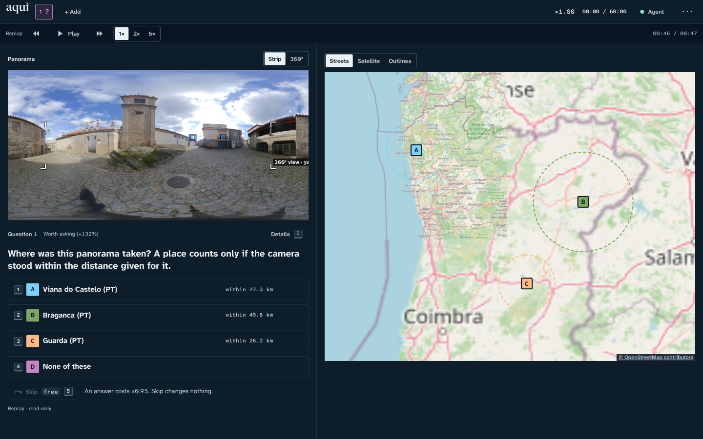
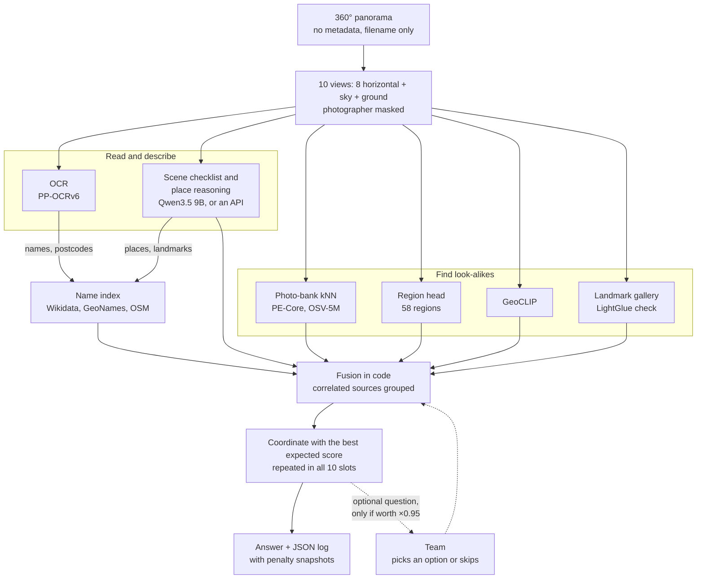
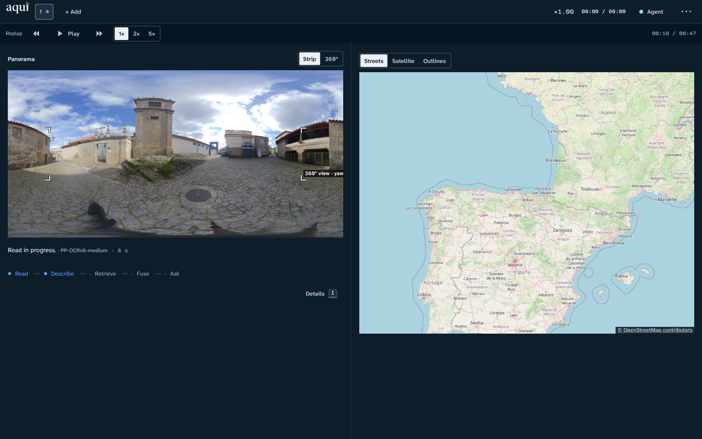
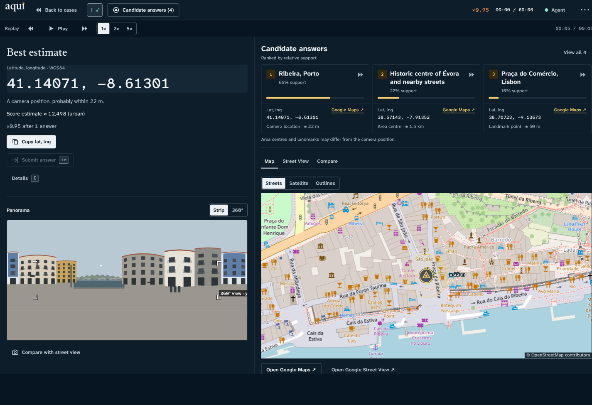
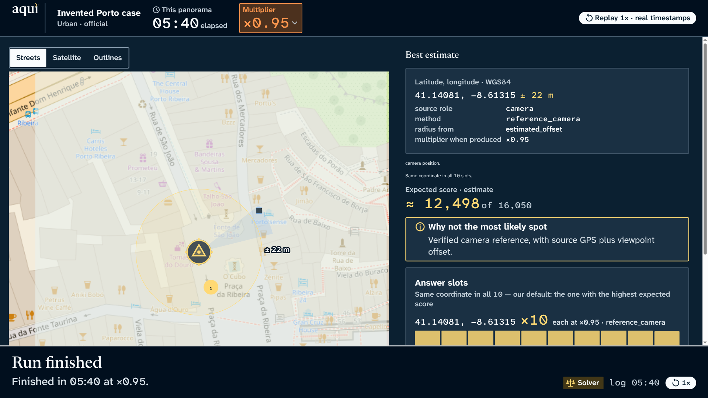
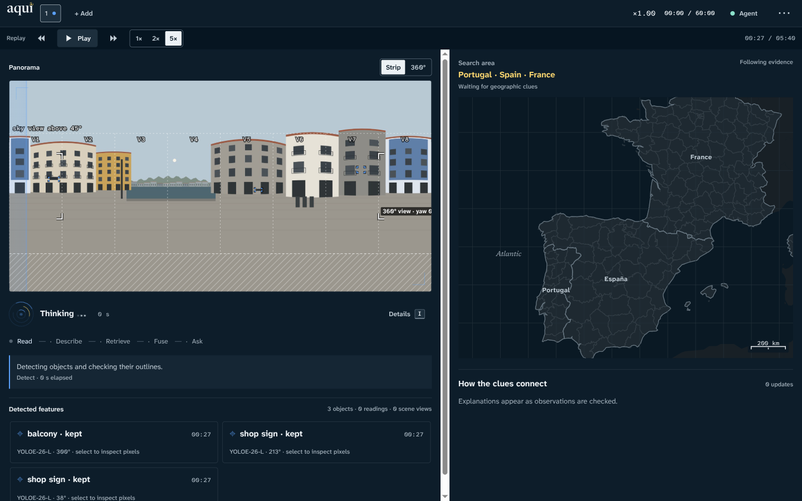

<div align="center">

<picture>
  <source media="(prefers-color-scheme: dark)" srcset="design_system/assets/Logos/aqui-wordmark-on-dark.svg">
  
</picture>

### Where was this 360° photo taken?

An AI agent built from local open-weight models. It takes a panorama from Portugal, Spain or France, finds where the camera stood, and shows every clue behind the answer. By default it runs entirely on one PC.

[](docs/RULES.md)
[](docs/challenge/Albatroz%20Challenge%20-%20JunctionX%20Lisbon%202026.pdf)
[](tools/setup_env.sh)
[](requirements.lock.txt)
[](docs/MODEL_DECISIONS.md)
[](app/)
[](docs/MODEL_DECISIONS.md)

[How it works](#how-it-works) · [The console](#the-operator-console) · [Results](#results) · [Running it](#running-it) · [Docs](#documentation)

<br>



<sub>A warm-up panorama in the console. The agent offers three places plus "None of these" and shows what an answer costs. Skipping is free.</sub>

</div>

<br>

## The challenge

This is our entry for the **Albatroz "Panorama Localisation" challenge** at JunctionX Lisbon 2026. Every panorama is a 6080 × 3040 equirectangular JPG with no EXIF, GPS or heading. The filename, with the capture time in UTC, is the only side information. The agent returns up to 10 ranked `(lat, lng)` guesses, and each one is scored on its distance to the true camera position:

| | Urban | Non-urban |
|---|---|---|
| Distance factor | `θ = 2 / (1 + d / 100 m)` | `θ = 2 / (1 + d / 10 km)` |
| Share of the points kept | 80% at 25 m, 25% at 300 m | two thirds at 5 km |

The first guess is worth `1000 × θ` and each rank below it is worth ×0.95 less. The team can help the agent, but every interaction costs points:

| Interaction | Cost on every later guess |
|---|---|
| Answer one of the agent's multiple-choice questions (≤ 4 options) | ×0.95 |
| Write a text cue (it must not name or hint at a place) | ×0.8 |
| Turn a place name into coordinates for the agent | ×0.5 |
| Skip a question | free, and the agent learns nothing from it |

Each panorama is solved on its own, from a clean state, with nothing carried over from another one. The full rules and the organisers' clarifications are in [`RULES.md`](docs/RULES.md).

## How it works



1. **Prepare.** Parse the filename, cut 8 overlapping views plus sky and ground, and mask the photographer at the bottom of the frame.
2. **Read and describe.** PP-OCRv6 reads every sign at full resolution and parses postcodes, phone numbers, plates, road numbers and place names. A vision-language model answers a closed checklist per view (sign language, façades, roofs, pavement, road furniture) and names the landmarks and places it recognises. **It never gives coordinates.**
3. **Find candidates.** PE-Core embeddings search a bank of about 100,000 street-level photos from OSV-5M and feed a 58-region classifier. GeoCLIP adds its own guesses. A Commons landmark gallery is matched and checked geometrically with ALIKED + LightGlue. A local name index (1.14 M Wikidata items, GeoNames and OpenStreetMap) turns names and postcodes into coordinates.
4. **Fuse in code.** Every clue becomes a weighted hypothesis, with weights calibrated on external validation data. Sources built on the same signal share a group and never confirm each other.
5. **Answer.** The agent picks the coordinate with the highest *expected* score and repeats it in all 10 slots. Each slot is scored independently and the rules give no bonus for spreading the guesses.
6. **Ask, sometimes.** A question is only worth asking when its expected gain beats the ×0.95 cost. Zone questions always include "None of these" or "Elsewhere", so a wrong earlier answer stays recoverable. Questions are **off by default** (see [Results](#results)).

<details>
<summary><b>Design rules the code keeps</b></summary>

<br>

- **Typed coordinates.** Every candidate says whether its point is a `camera` position, a `landmark` or the centre of an `area`. A Wikidata point, an OSM shop or a postcode centroid is not where the camera stood.
- **Probability stays in code.** Models observe; the solver decides. The VLM never supplies coordinates, or digits that OCR didn't read.
- **Uncertainty stays visible.** An output carries its source and a radius, or says the radius is unknown.
- **A skip carries no meaning.** The agent's beliefs stay exactly as they were, and no question is written so that silence means "no".
- **One panorama at a time.** A new evidence file and a new conversation for every panorama, with no priors from other panoramas taken the same day.
- **Every step is logged.** Each panorama writes a replayable JSON log with the penalty multiplier at every output.

</details>

## The operator console

**Aqui** is the team's console for the scoring run. Detections appear on the panorama as they arrive, the map narrows with the evidence, and every claim links back to the pixels it came from. Questions show their cost before you click, and a whole run can be replayed from its log.

<table>
  <tr>
    <td width="50%"></td>
    <td width="50%"></td>
  </tr>
  <tr>
    <td><sub><b>Live run.</b> OCR and the scene checklist work through the views while the map waits for geographic clues.</sub></td>
    <td><sub><b>Candidate answers.</b> Each one carries its support, its coordinate type and its radius (invented demo case).</sub></td>
  </tr>
  <tr>
    <td></td>
    <td></td>
  </tr>
  <tr>
    <td><sub><b>Stage mode</b> for the projector: the estimate, its radius, the multiplier and the expected score (invented demo case).</sub></td>
    <td><sub><b>Detected features.</b> Select any observation to see the pixels it came from (invented demo case).</sub></td>
  </tr>
</table>

The console is React + Vite with MapLibre and Pannellum, built on its own [design system](design_system/README.md). It bundles its fonts, icons and map outlines, so replays work with no network and no models. Keyboard shortcuts, stage mode, case reports and the live HTTP/SSE contract are documented in [`app/README.md`](app/README.md) and [`app/CONTRACT.md`](app/CONTRACT.md).

## Results

Measured on the 19 primary warm-up panoramas, against the team's reference locations (the organisers confirmed 17 of them to within 10–30 m). The score is the mean challenge score as a share of the 16,050-point maximum. Every row is the fully local setup, with Qwen3.5 9B as the VLM. Every run and its settings are in [`EVALUATION.md`](docs/EVALUATION.md).

| Configuration | Score | Median first-guess error | Urban within 100 m |
|---|---:|---:|---:|
| OCR, scene checklist, name index and fusion | 2.7% | 257.5 km | 0 of 17 |
| &nbsp;&nbsp;+ photo-bank kNN, region head and GeoCLIP | 8.9% | 122.2 km | 0 of 17 |
| &nbsp;&nbsp;+ zones, cells and landmarks, with a simulated team answering | 24% | 7.3 km | 5 of 17 |
| Through the app, every question answered correctly (oracle) | 32.5% | 109 m | 8 of 17 |

<sub>The simulated team answers 70% of questions right, 10% wrong and skips 20%, seeded per panorama. The oracle row can't be reached in practice and is there as a ceiling for the question loop.</sub>

- **Questions are off by default.** With a realistic simulated team (some wrong answers, and skips that stay skipped), every question gate we tried lost points against never asking ([decision D5](docs/ROADMAP.md#d5--sunday-0530--no-questions-by-default)). `--ask-anyway` turns them back on.
- **Answers help most when the agent is far off.** With correct answers, country and district questions moved five first guesses from 118–434 km off to 179–579 m. When the agent is already close, a correct answer only confirms its pick and still costs ×0.95.
- **Time:** about 45–55 s from the start of a run to its first answer, on a laptop RTX 5080 held at 80 W.

## Running it

### Fully local, by default

With no API key, **everything runs on your PC**: the vision-language model (Qwen3.5 9B through Ollama), OCR, photo-bank retrieval, GeoCLIP, landmark matching, the name index and fusion. No panorama leaves the machine, and once the models and data are downloaded the pipeline needs no network (`HF_HUB_OFFLINE=1`). The console's street and satellite map tiles are the only optional online part, and it falls back to bundled outlines without them.

That needs a capable machine. Everything in this README was built and measured on this one:

| | Our machine |
|---|---|
| **GPU** | NVIDIA RTX 5080 Laptop, 16 GB (Blackwell, `sm_120`), held at 80 W |
| **GPU memory in use** | 8.3 GB once every model is warm, 5.4 GB of it for Qwen3.5 9B |
| **CPU** | Intel Core Ultra 9 275HX, 24 threads (OCR runs here, through OpenVINO) |
| **RAM** | 30 GB |
| **Disk** | about 55 GB: Python environment 8.5 GB, model weights about 25 GB, data and indexes about 22 GB |
| **OS** | Debian 13, Linux 6.12, NVIDIA driver 590 |
| **Software** | Python 3.12, PyTorch 2.11 (CUDA 12.8), Node 20.19+, [Ollama](https://ollama.com/) 0.34.4 |

Other NVIDIA GPUs with 16 GB should work. We haven't tested smaller cards, other operating systems or CPU-only runs.

### With an API key, optionally

The two VLM steps, the per-view scene checklist and the whole-panorama place reasoning, can run on a hosted multimodal LLM instead, from whichever provider you have a key for. Everything else stays on the PC. Qwen stays loaded as the fallback, so if a hosted call fails, that panorama carries on locally. The PC needs the same hardware either way. In this mode the views sent to the VLM leave your machine, and your provider's usage fees apply.

The hook is provider-neutral. Add a module `panoloc/local_vlm.py` that wraps your provider, and the pipeline imports it when it exists (`VLM_PLUGIN` in `panoloc/pipeline.py`):

```python
def make_client(model):     # a client with .model and .chat(system, text, schema, images=...), like
    ...                     # panoloc.vlm.OllamaClient; return None when no key is set, and the run stays local
def selected_model(model):  # the hosted model's name, or None
    ...
def claims(model):          # True for the model names this adapter serves
    ...
```

The repository ships no adapter, so a fresh clone always runs fully local. `PANOLOC_VLM=local` forces the local model even when an adapter is present.

### Quick start

**Just the console, with no models.** It replays the bundled demo cases with no backend:

```bash
cd app
npm install
npm run dev            # http://127.0.0.1:5178/
```

**The full agent:**

```bash
tools/setup_env.sh     # Python 3.12 venv in .venv/ and every model weight (about 25 GB, resumable)

# one panorama, end to end, in the terminal
HF_HUB_OFFLINE=1 .venv/bin/python -m panoloc.pipeline "Data/Panorama Warm-Up/IMG_20250125_151032_00_611.jpg"

# the console with the real pipeline behind it, supervised, on http://127.0.0.1:5178/
app/start.sh start
```

The pipeline needs the photo bank, the name index and the zone outlines. They are gitignored, and the scripts in `tools/` rebuild them:

<details>
<summary><b>Download the data and build the indexes</b></summary>

<br>

Every script is resumable: run it again to fill any gaps. Each one's usage is in its header.

```bash
tools/fetch_osv5m.sh                              # OSV-5M photo bank (PT/ES/FR)
tools/fetch_geo.sh                                # GeoNames, CAOP + geoBoundaries, GHSL, OSM extracts, GLO-90
python3 -I tools/fetch_wikidata.py --out Data/wikidata
python3 -I tools/fetch_commons.py plan --extract Data/wikidata/wikidata_ptesfr.csv.gz --out Data/gallery/commons
python3 -I tools/fetch_commons.py fetch --dirs Data/gallery/commons/PT --contact <your-contact-url> --max-rps 2

python3 -I tools/build_name_index.py              # Wikidata + GeoNames name index (about 75 s)
.venv/bin/python -I tools/build_osm_index.py PT   # OSM names per country (PT 2 min, ES 9, FR 20)
.venv/bin/python -I tools/build_zones.py          # zone outlines for zone questions (about 3 min)
.venv/bin/python tools/bank_partitions.py         # split the bank into train / val / test
.venv/bin/python tools/embed_bank.py              # PE-Core embeddings of the photo bank
.venv/bin/python tools/train_region_head.py       # the 58-region head
```

</details>

<details>
<summary><b>Tests and evaluation</b></summary>

<br>

```bash
.venv/bin/python -m unittest discover -s tests                     # the pipeline
.venv/bin/python -m unittest discover -s app/dev -p 'test_*.py'    # the live server
cd app && npm test                                                  # the console

# score the pipeline on external validation panoramas (Panoramax, camera GPS)
.venv/bin/python tools/evaluate.py run --set val --predict panoloc.pipeline:predict --limit 30
```

The warm-up references are for evaluation only. They never reach the agent's inputs, the photo bank, training or calibration.

</details>

## Repository layout

```text
docs/             the plan, rules, model decisions, evaluation, roadmap, tasks and the challenge PDFs
panoloc/          the agent: views, OCR, VLM, retrieval, names, zones, cells, fusion, questions, pipeline
app/              Aqui, the operator console (React + Vite), and its live and mock servers
design_system/    tokens, components and design rules behind the console
knowledge_base/   country clues as machine-readable rules and lookup tables
tools/            environment setup, downloads, index builds, evaluation, calibration and a 360° viewer
streetclip/       a separate zero-shot StreetCLIP baseline (image to place names to coordinates) and its results
tests/            unittest suite for panoloc/
Data/             the warm-up panoramas (downloaded data and indexes are gitignored)
```

## Documentation

| File | What's in it |
|---|---|
| [`docs/RULES.md`](docs/RULES.md) | The scoring formula, the interaction rules and the organisers' clarifications |
| [`docs/challenge/`](docs/challenge/) | The organisers' challenge brief and their "Praying for Portugal" write-up (PDF) |
| [`docs/PLAN.md`](docs/PLAN.md) | The pipeline design, the output contract, questions, evaluation gates and timeline |
| [`docs/MODEL_DECISIONS.md`](docs/MODEL_DECISIONS.md) | Which model fills each role, the GPU memory plan, platform pins and what was rejected |
| [`docs/COUNTRY_CLUES.md`](docs/COUNTRY_CLUES.md) | How to tell Portugal, Spain and France apart: plates, signs, street furniture, buildings, language |
| [`docs/EVALUATION.md`](docs/EVALUATION.md) | The frozen evaluation policy and every scored run |
| [`docs/ROADMAP.md`](docs/ROADMAP.md) | Phases, gates, risks and every change of plan |
| [`docs/TASKS.md`](docs/TASKS.md) | The task tracker, kept by `tools/tasks.py` |
| [`app/README.md`](app/README.md) | Running and using the console |
| [`design_system/README.md`](design_system/README.md) | The console's design rules and components |

## Credits

**Models:** [PP-OCRv6](https://github.com/PaddlePaddle/PaddleOCR) through [RapidOCR](https://github.com/RapidAI/RapidOCR) and OpenVINO · [Qwen3.5](https://github.com/QwenLM) through Ollama · [Perception Encoder (PE-Core)](https://github.com/facebookresearch/perception_models) · [GeoCLIP](https://github.com/VicenteVivan/geo-clip) · [ALIKED](https://github.com/Shiaoming/ALIKED) + [LightGlue](https://github.com/cvg/LightGlue) · [MegaLoc](https://github.com/gmberton/MegaLoc) · [StreetCLIP](https://huggingface.co/geolocal/StreetCLIP) (the `streetclip/` baseline)

**Data:** [OSV-5M](https://huggingface.co/datasets/osv5m/osv5m) · [Panoramax](https://panoramax.fr/) · [Wikidata](https://www.wikidata.org/) · [Wikimedia Commons](https://commons.wikimedia.org/) · [GeoNames](https://www.geonames.org/) · [OpenStreetMap](https://www.openstreetmap.org/copyright) (© OpenStreetMap contributors, ODbL) · [CAOP 2025](https://www.dgterritorio.gov.pt/) · [geoBoundaries](https://www.geoboundaries.org/) · [GHSL](https://human-settlement.emergency.copernicus.eu/) · [Copernicus GLO-90](https://spacedata.copernicus.eu/)

**Console:** [React](https://react.dev/) · [MapLibre GL](https://maplibre.org/) · [Pannellum](https://pannellum.org/) · fonts [Newsreader](https://fonts.google.com/specimen/Newsreader) and [Atkinson Hyperlegible](https://www.brailleinstitute.org/freefont/) (SIL OFL)

Every dataset keeps its own licence. The warm-up panoramas and the challenge PDFs belong to the organisers.

<div align="center">
<br>

<br>
<sub>Built at JunctionX Lisbon 2026.</sub>
</div>
