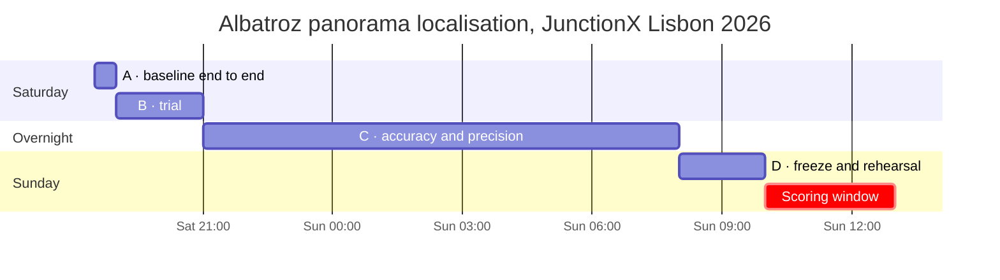
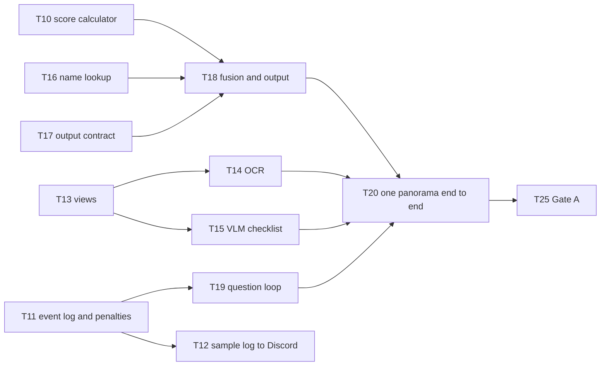

# Roadmap

**Updated:** Sunday 2026-10-11, 00:30: decision D1, a testing app by 06:00 (see Decisions).
**Related:** [TASKS.md](TASKS.md) holds every task and its status; [PLAN.md](PLAN.md) section 5 has the gates in full; [RULES.md](RULES.md) has the schedule.

The order of work is fixed by the plan: a complete, logged answer first, then accuracy, then optional components. Each phase ends at a gate, and a phase adds models only after the gate before it has passed. Task status lives in TASKS.md. This file changes only when a phase window, a gate or the critical path changes.

## Timeline

| Phase | Window | Goal | Gate | Gate task |
|---|---|---|---|---|
| A | until Saturday 19:00 | One panorama end to end, with a valid log | A complete coordinate output and a reviewable log, including a skipped question and a failed optional stage | T25 |
| B | Saturday 19:00–21:00 | Trial: run the baseline, submit a log, find what breaks | Usable logs, a working human loop and a known time budget | T30 |
| C | Saturday 21:00 to Sunday 08:00 | Accuracy: embeddings, kNN, mini-PIGEON, fusion, precise coordinates | The PLAN 4.8 accuracy targets, branch checks, valid logs, ≤ 150 s initial processing, ≤ 14 GB GPU | T52 |
| D | Sunday 08:00–10:00 | Freeze, then rehearse on six unfamiliar panoramas | Gate C, plus the rehearsal within 60 minutes meeting PLAN 4.8 | T59 |
| Run | Sunday 10:00–13:00, then the presentation and the final | 5 panoramas plus the Special One in 60 minutes of solving | | T60–T63 |
| Backlog | after the gates | Optional components, each only after a measured gain (PLAN 4.7); work deferred by D1 | | T44, T51, T64–T75, T77 |

## Where we stand (Sunday 00:30)

- **The pipeline runs end to end** (T20): views, OCR, VLM checklist, names (Wikidata, GeoNames, and OSM for Portugal and Spain), fusion with kNN, the region head and GeoCLIP, questions with skips, coordinates and the log. Gate A (T25) still needs its formal check.
- **Done overnight:**
  - the bank embeddings, kNN index and region head (T35–T37)
  - GeoCLIP (T38)
  - the Commons embeddings (T33) and the MegaLoc + LightGlue check (T41)
  - the zone outlines (T32) and the OSM names (T31)
  - the warm-up validation (T40)
- **In progress:** fusion calibration (T39), the cell route (T42), the VLM comparison (T47), the app bridge (T76), and the Commons download (T06).
- **Phase B slipped.** The trial window passed without a trial run. Its tasks now run through the app at 02:00–04:00 (D1).
- **The GPU is still capped at 80 W** (T48), so every timing is a lower bound.

## Decisions

Each entry records what was decided, what was set aside, and how to go back. Task notes carry the decision's ID (grep TASKS.md for it).

### D1 · Sunday 00:30 · Speed mode until the 08:00 freeze, for a testing app by 06:00

**Decision:** the team wants a testing app by 06:00. That means the operator console (T50) running real panoramas through the real pipeline, with live events, answers and skips. Until the 08:00 freeze, time goes to that path first.

**The 06:00 plan:**

| Time | Work | Tasks |
|---|---|---|
| 00:30–02:00 | Bridge between the app and the pipeline; the cell route lands; named zones wired into the pipeline | T76, T42, T32 |
| 02:00–04:00 | Warm-up and external val panoramas run through the app; mismatches fixed; per-panorama times and failures recorded. Queued at 01:05: urban probability from GHSL for the question gate, so urban scenes refine to 25 m | T26, T29, T80 |
| 04:00–05:30 | Timeouts, offline fallback, one worker with a queue, GPU memory check | T46 and T49 basics |
| 06:00 | Testing app ready; then the accuracy gates and the rehearsal until 08:00 | T43, T52 |

**Speed rules until 08:00:**
- New code gets one smoke test per feature, plus the full regression suite (`.venv/bin/python -m unittest discover -s tests`, about 40 s).
- Docs: a usage line, not full docstrings or CLAUDE.md polish.
- Validation: about 30 panoramas instead of 207. Exceptions: the final gates T43, T52 and T54 keep full size, and fusion re-runs over perception that is already cached stay cheap.
- **Recording shortcuts:** every task finished under these rules lists what it skipped in a note starting "D1 debt:".

**Set aside, and how to go back:**

| Set aside | State | To go back |
|---|---|---|
| T44 YOLOE detector crops | moved to Backlog | `python3 tools/tasks.py update T44 --phase C` |
| T51 MODEL_DECISIONS corrections | moved to Backlog | `python3 tools/tasks.py update T51 --phase C` |
| Backlog T64–T75 | untouched; decided at T45 | as before |
| T47 Qwen vs Gemma | finishes its last ~15 min GPU run; no further VLM comparisons before 06:00 | re-run `tools/compare_vlm.py` |
| Cues during a run | not in app v1 (`run_panorama` takes no cue) | T78 |
| Venue map tiles, organiser submission format | after 06:00 | T50, T56 |
| French OSM name index | Built but not attached. A re-test at 01:30 on cached val with the current fusion showed no French gain (660 both ways) and a small Spanish loss (1,647 → 1,623). The French score comes from the photo bank and GeoCLIP, because the French panoramas show few readable names. | `mv Data/index/osm_FR.pending.sqlite Data/index/osm_FR.sqlite`, then restart the app (T31) |
| Full tests, docs and full-size validation for D1 work | owed | T77: the "D1 debt:" notes list each item |
| The Phase B trial as a separate step | folded into the app runs at 02:00–04:00 | T26–T30 keep their rows and Gate B |

**Not changed:** the partner rules, the evaluation-only status of `Data/warmup_locations.json`, the PLAN 1.1 output rule, and the gates' criteria.

### D2 · Sunday 02:30 · Judge on the warm-up by comparing coordinates

**Decision (user):** the organiser-checked warm-up references are good enough as ground truth (RULES.md, "Organiser feedback on our warm-up references": 13 within 10 m, the other 4 at 14–30 m).

- **How we judge:** a change is judged on the warm-up by comparing the agent's output coordinates with the references, using plain Haversine distance and the challenge score at that distance. The robust and conservative variants (`d_ref + radius`) become secondary columns.
- **The gates:** the PLAN 4.8 targets in EVALUATION.md (urban within 100 m for 9 of 17; mean score at least 30%) are read on these nominal distances.
- **Diagnosis:** a warm-up failure may be diagnosed by comparing the run's coordinates and answers with its reference (for example 319's early stop), inside evaluation code.
- **Unchanged:**
  - **Agent isolation:** the references and anything derived from them never reach the agent's inputs, prompts, photo bank, training or galleries.
  - **Fixes must be generic:** never special-case one panorama.
  - **Weight fitting stays on external val:** we still fit numeric weights there (T39), because 20 panoramas are easy to overfit. Val stays the secondary check.
- **To go back:** judge on val only, with the robust and conservative columns as primary, as in EVALUATION.md before 02:30.

### D3 · Sunday 02:39 · A simulated team can pass Gate C

**Decision (user):** asked "Can the script team's run pass Gate C?", the user answered "Yes".

- **What can pass Gate C:** runs of the retained configuration answered by the simulated human (`panoloc.oracle` human mode: 70% right, 10% wrong, 20% skips, seeded per panorama), not only real-team runs.
- **Gate D unchanged:** its rehearsal still needs the real team answering 6 unfamiliar panoramas (T55).
- **Timing:** the decision came before any score of the realistic batch (`runs/app/batch-20261011-023634-human`, started 02:36) existed, so that batch falls under it (PLAN 4.8: no retrospective passes).
- **Still cannot pass:** always-right (nominal oracle) runs and autonomous runs, which stay reported only.
- **To go back:** only real-team runs pass Gate C, as in EVALUATION.md before 02:39.

## Critical path to Gate A

The arrows are the Needs in TASKS.md on Saturday 18:30; TASKS.md is the live version.

T10, T11, T13, T16 and T17 can start now, one per person. T09 (environment smoke test) runs alongside them.

## What each area delivers

The areas are the PLAN.md section 7 roles, plus `ui` and `team`.

| Area | A: until 19:00 | B: trial | C: overnight | D: Sunday morning |
|---|---|---|---|---|
| pipeline | Scorer, event log, penalties, question loop, end-to-end run | Run the trial panoramas and time them | Warm-up validation, queue, rehearsal with failures | Output and log export |
| perception | Views, OCR, VLM checklist | List missed text | Qwen vs Gemma; detector crops only if failures call for them | |
| geo | Name lookup, output contract, fusion | List missing candidate areas | Full name index, zone boundaries, landmark gallery, MegaLoc, cell route | |
| pixel | Start PE-Core embeddings; pick the validation set | | Partitions, embeddings, kNN, mini-PIGEON, GeoCLIP | One final external evaluation |
| ui | | | Operator console v1 from the event log | |
| team | Organiser questions, sample log | Submit a log, record feedback and failures | Accuracy gate | Freeze, rehearsal, Sunday roles |

## Sunday (PLAN section 6)

- **Roles:** one operator runs the agent; a finder starts locating each panorama with Google Lens and maps as soon as it arrives; the others check the agent's options in Street View.
- **Budget:** about 8 minutes per ordinary panorama, 15 for the Special One and 5 of buffer.
- **Each panorama:** fresh state, an initial answer first, then refinement where it pays. Skipping a question is free and carries no information.

## Risks

| Risk | Effect | Response | Task |
|---|---|---|---|
| Organiser answers pending: log schema, Urban labels, runtime network access, feedback | Rework of the log or the question loop | Ask now; record the answers in RULES.md | T08 |
| GPU capped at 80 W | The 150 s budget is measured on a slow GPU | Lift the cap; time the real configuration | T48 |
| Commons throttling | A smaller landmark gallery by Sunday | Embed whatever has arrived, in priority order | T06, T33 |
| Overpass and map tiles slow or failing from the venue | A live lookup stalls a panorama | Offline assets only; prefetch tiles for the console | T31, T50 |
| A rule breach: one panorama informing another, or warm-up references reaching the agent | The approach breaks the partner rules | Fresh state per panorama; warm-up references for evaluation only | T11, T23 |
