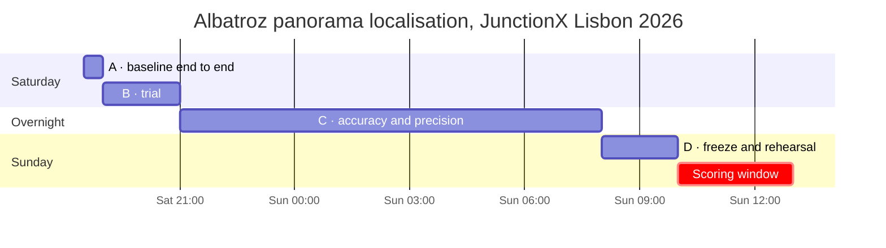
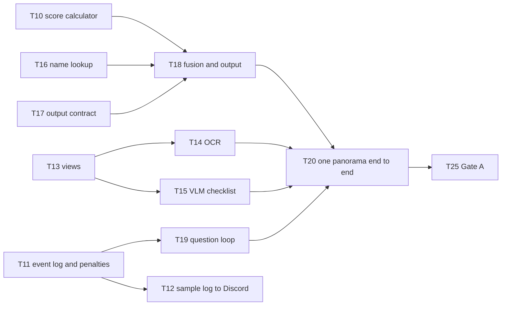

# Roadmap

**Updated:** Saturday 2026-10-10, 18:30.
**Related:** [TASKS.md](TASKS.md) holds every task and its status; [PLAN.md](PLAN.md) section 5 has the gates in full; [RULES.md](RULES.md) has the schedule.

The order of work is fixed by the plan: a complete, logged answer first, then accuracy, then optional components. Each phase ends at a gate, and a phase adds models only after the gate before it has passed. Task status lives in TASKS.md. This file changes only when a phase window, a gate or the critical path changes.

## Timeline

| Phase | Window | Goal | Gate | Gate task |
|---|---|---|---|---|
| A | until Saturday 19:00 | One panorama end to end, with a valid log | A complete coordinate output and a reviewable log, including a skipped question and a failed optional stage | T25 |
| B | Saturday 19:00–21:00 | Trial: run the baseline, submit a log, find what breaks | Usable logs, a working human loop and a known time budget | T30 |
| C | Saturday 21:00 to Sunday 08:00 | Accuracy: embeddings, kNN, mini-PIGEON, fusion, precise coordinates | The PLAN 4.8 accuracy targets, branch checks, valid logs, ≤ 150 s initial processing, ≤ 14 GB GPU | T52 |
| D | Sunday 08:00–10:00 | Freeze, then rehearse on six unfamiliar panoramas | Gate C, plus the rehearsal within 60 minutes meeting PLAN 4.8 | T59 |
| Run | Sunday 10:00–13:00, then the presentation and the final | 5 panoramas plus the Special One in 60 minutes of solving | | T60–T63 |
| Backlog | after the gates | Optional components, each only after a measured gain (PLAN 4.7) | | T64–T75 |

## Where we stand (Saturday 18:30)

- **Data is nearly all in.** The OSV-5M bank is verified, and the Wikidata, GeoNames, CAOP, geoBoundaries, GHSL, OSM Portugal and Spain, and Portugal elevation downloads are done. Still running: OSM France and the Spain/France elevation tiles (T04), model weights (T05), Commons landmark photos (T06), Panoramax France (T07).
- **There is no pipeline code yet, and the trial starts at 19:00.** Phase A will run into the trial window. At 19:00 the trial is worth more as a check of the log format (T12, T27) than as a scored run, so the event log (T11) comes first.
- **The GPU is still capped at 80 W** (T48). Every timing measured now is a lower bound.
- **The Commons gallery will be partial.** Wikimedia throttles the download; its order puts heritage sites and much-linked items first, so a partial gallery still covers the most likely landmarks (T06, T33).

## Critical path to Gate A

The arrows are the Needs in TASKS.md on Saturday 18:30; TASKS.md is the live version.

T10, T11, T13, T16 and T17 can start now, one per person. T09 (environment smoke test) runs alongside them.

## What each area delivers

The areas are the PLAN.md section 7 roles, plus `ui` and `team`.

| Area | A: until 19:00 | B: trial | C: overnight | D: Sunday morning |
|---|---|---|---|---|
| pipeline | Scorer, event log, penalties, question loop, end-to-end run | Run the trial panoramas and time them | Warm-up validation, queue, rehearsal with failures | Output and log export |
| perception | Views, OCR, VLM checklist | List missed text | Qwen vs Gemma; detector crops only if failures call for them | |
| geo | Name lookup, output contract, fusion | List missing candidate areas | Full name index, zone boundaries, landmark gallery, MegaLoc, cell route | |
| pixel | Start PE-Core embeddings; pick the validation set | | Partitions, embeddings, kNN, mini-PIGEON, GeoCLIP | One final external evaluation |
| ui | | | Operator console v1 from the event log | |
| team | Organiser questions, sample log | Submit a log, record feedback and failures | Accuracy gate | Freeze, rehearsal, Sunday roles |

## Sunday (PLAN section 6)

- **Roles:** one operator runs the agent; a finder starts locating each panorama with Google Lens and maps as soon as it arrives; the others check the agent's options in Street View.
- **Budget:** about 8 minutes per ordinary panorama, 15 for the Special One and 5 of buffer.
- **Each panorama:** fresh state, an initial answer first, then refinement where it pays. Skipping a question is free and carries no information.

## Risks

| Risk | Effect | Response | Task |
|---|---|---|---|
| Organiser answers pending: log schema, Urban labels, runtime network access, feedback | Rework of the log or the question loop | Ask now; record the answers in RULES.md | T08 |
| GPU capped at 80 W | The 150 s budget is measured on a slow GPU | Lift the cap; time the real configuration | T48 |
| Commons throttling | A smaller landmark gallery by Sunday | Embed whatever has arrived, in priority order | T06, T33 |
| Overpass and map tiles slow or failing from the venue | A live lookup stalls a panorama | Offline assets only; prefetch tiles for the console | T31, T50 |
| A rule breach: one panorama informing another, or warm-up references reaching the agent | The approach breaks the partner rules | Fresh state per panorama; warm-up references for evaluation only | T11, T23 |
