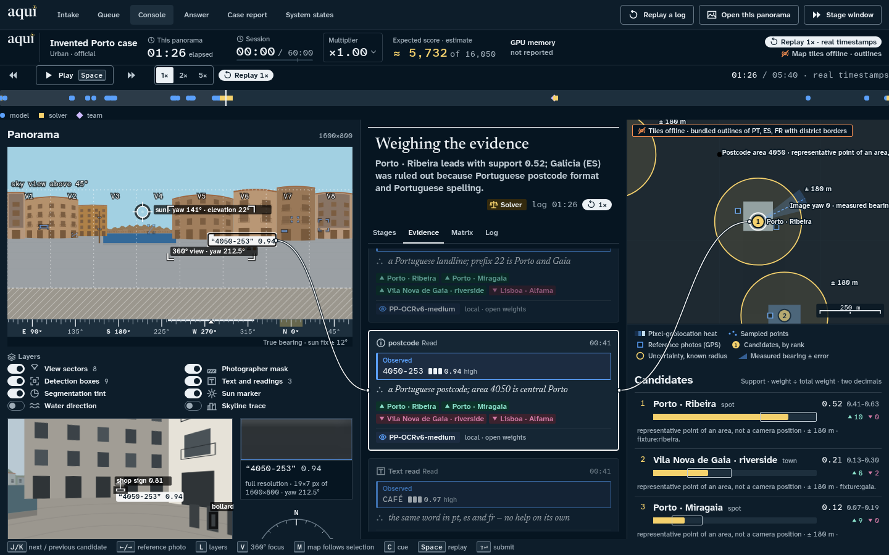
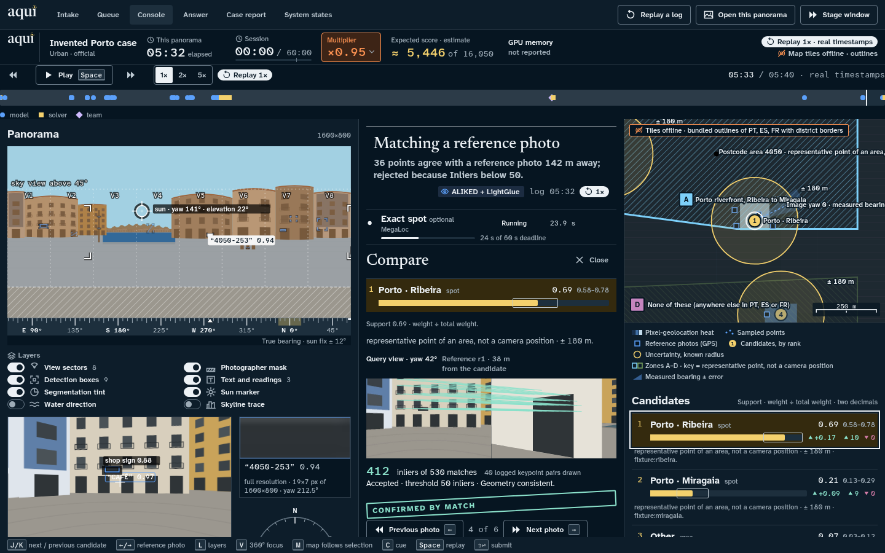
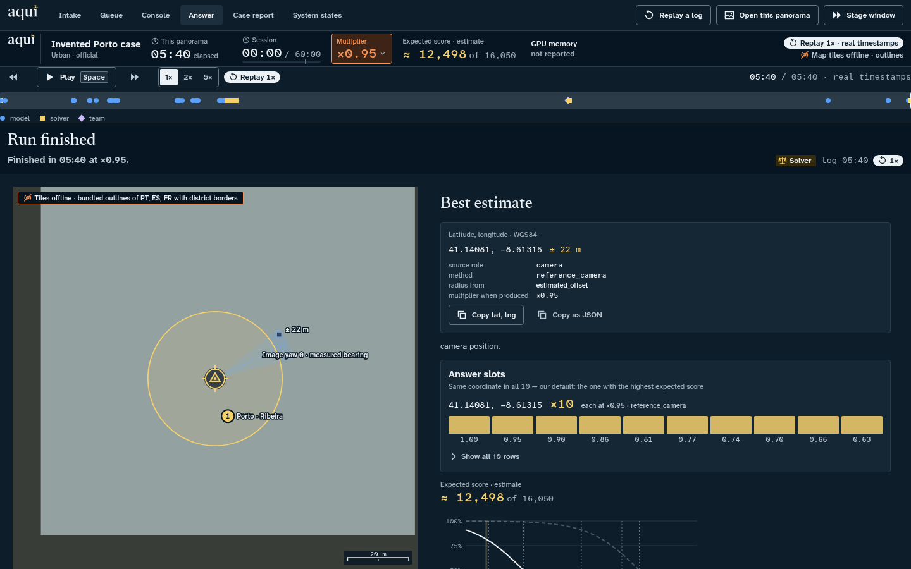
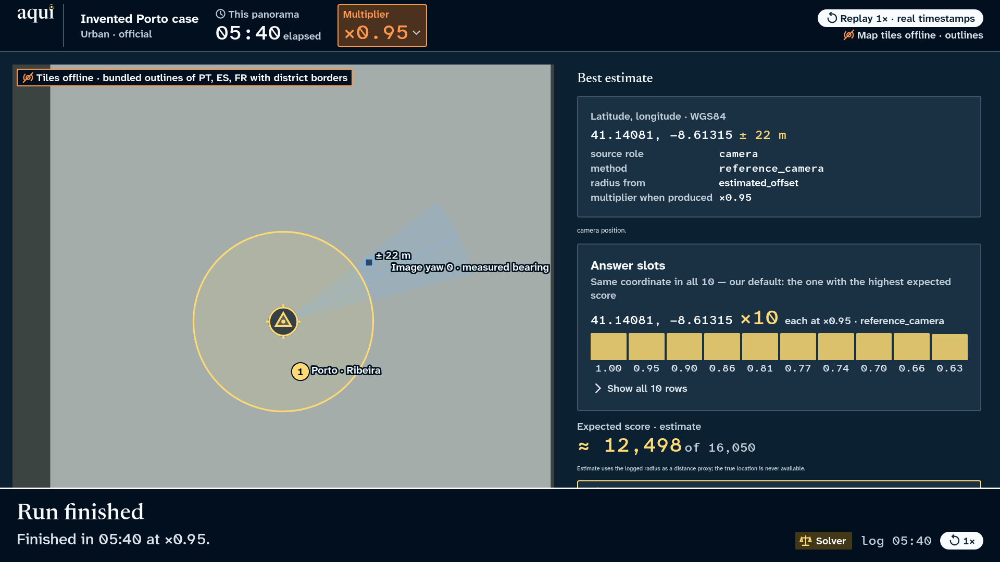

# Aqui frontend build report

2026-10-11 · Model-directed answer review and question probabilities (T84).

Completed live answers now offer **Investigate further** in Focus and Full console. The VLM reviews the current output, original panorama, candidate evidence and earlier responses, then chooses to keep the answer, ask itself a specific photo question, or ask a human question. **Thinking** keeps the current coordinates visible. Review resumes the same Run, sequence, question constraints, answer history and penalty counters. A human confirmation retains a refined camera coordinate when it fits the chosen area. All question options now show **Agent probability**, including none/outside options; review uses a validated model distribution, and ordinary questions use their logged candidate support. Missing estimates remain unavailable.

Each request permits three decisions, one free self-check and two human questions. Three review requests are accepted per run; model calls have a 45-second timeout and share a 180-second budget. Self-checks resolve place names through the existing index and replace the VLM clue group. Human answers retain the ×0.95 receipt, skips are neutral and end the request, and failures preserve the latest coordinate with the current penalty. Replay stays read-only. Review is available for new completed runs in the current live backend session.

Validation: strict TypeScript/Vite build, **65 frontend tests**, **420 repository tests** (one existing skip), **27 backend tests**, and seven browser checks passed. The browser used an isolated real HTTP worker/controller/SSE with deterministic VLM replies and a procedural image; it covered self → human → answer, keyboard answer/skip, receipt preservation, repeated review limits, Focus/Full probabilities and 390 px layout. No JavaScript errors occurred, and no active or evaluation run was modified. These checks verify the mechanism and presentation; localisation accuracy has not been measured for this review policy.

Evidence: [browser verification](answer-review-verification.json), [Thinking](screenshots/answer-review-thinking.png), [question probabilities](screenshots/answer-review-question.png), [mobile](screenshots/answer-review-mobile.png). The frontend is published; the backend was restarted only after the live queue finished, with its saved settings preserved. `/api/status` confirms answer review enabled and all nine models resident. The isolated test server and browsers are closed.

---

2026-10-11 · Candidate answers and coordinates (T50 follow-up).

The toolbar now has **Candidate answers (N)**, a direct link to the full list during Working, questions and completed answers. Working and Answer show the leading three candidates above the map, with numbered cards, relative support, latitude/longitude and individual Google Maps links. **View all N** opens the complete list. Coordinates are also visible in that list and in Compare; absent positions stay explicitly unavailable. Area centres and landmark points retain their distinct roles. Inspecting candidates leaves the final prediction, question and penalty receipts intact. Focus stays inside Details when a candidate row is replaced by its comparison, and the tile canvas resizes when the map height changes.

Validation: strict TypeScript/Vite build and **62 frontend tests** passed. Eight production browser checks passed with bundled outlines, covering Working, questions, Answer, Full console, complete and missing coordinates, full precision in map links, keyboard navigation, unchanged predictions/penalties and a 390 px viewport without horizontal overflow. The same checks passed against the live tile proxy, plus a check that the canvas follows the changing map height. Neither pass recorded JavaScript errors or API writes. The checks use invented candidates and a procedural image, with no evaluation run modified. The frontend build is published on the live console.

Evidence: [outline checks](candidate-answers-verification.json), [live tile checks](candidate-answers-tiles-verification.json), [desktop](screenshots/candidate-answers-desktop.png), [mobile](screenshots/candidate-answers-mobile.png).

---

2026-10-11 · Google Maps links and unavailable street photos (T50 follow-up).

Completed maps in Focus, Full and Stage views now show **Open Google Maps** and **Open Google Street View**. The links use the full predicted coordinates, including negative values; Street View and Compare retain the same links even with no photos or failed downloads. Nearby camera coordinates never replace the estimate. The frontend build is published on the live console.

Investigation found sparse public coverage at generic Lisbon/Porto city-centre coordinates (one/two returned panoramas within 1 km, none within 50 m) and an actual loading failure: the federation catalog returned OSM-France photos while `panoramax.openstreetmap.fr` was unreachable from this machine; an IGN-hosted image loaded successfully. The service now reserves the nearest photo from each supported image host, scopes circuit breakers to individual hosts, and uses a 30-second cooldown after an image-host failure. The frontend automatically advances past failed photos, tries each once and stops after eight. The search-cache version was advanced so old lists containing only the unreachable host are refreshed.

Validation: strict TypeScript/Vite build, **62 frontend tests**, **24 backend tests**, and eight production browser checks passed with no JavaScript errors. Checks cover actual link navigation, full coordinate precision, Focus/Full/Stage, estimate changes, camera/estimate separation, bounded automatic fallback, all failed/empty photos and a 390 px viewport. A real public Paris panorama loaded after eight photo attempts through both an isolated test instance and the updated live backend, using a procedural original and no evaluation images. The main backend was left uninterrupted until its evaluation batch finished, then restarted while idle with its saved flags preserved. The patch is live and all nine models are warm. The temporary test server and test browsers were closed.

Evidence: [browser verification](google-maps-verification.json), [provider investigation](google-maps-investigation.json), [final map links](screenshots/final-google-maps.png), [mobile empty coverage](screenshots/streetview-google-maps-mobile.png), [real public fallback](screenshots/streetview-google-maps-fallback.png).

---

2026-10-11 · Detection motion and street panorama comparison (T50).

The requested richer focus experience is implemented: logged object corner paths and 360° boxes draw on arrival, readings/cards and candidate support transition, and a slow scan plus orbiting activity/dots accompany the **Thinking** label. Reduced motion disables continuous effects. The original panorama remains visible beside the answer controls. Answer adds **Map / Street View / Compare**; Compare places the original and nearby street panorama side by side, with manual alignment, linked turning/pitch/zoom, held F flicker and nearby-photo navigation. Candidate Compare also offers a Street View source.

The local backend provides display-only `/api/streetview/nearest` and image routes. Panoramax works without a key; optional Mapillary uses a server-only token. Requests are bounded, public-host checks also apply to the IGN object-storage redirect, repeated failures use a circuit breaker, and metadata/images are cached under `runs/app/streetview/`. No uploaded image, crop, run ID or model event is passed to the service. It writes no run event, changes no answer and charges no penalty. No imagery request starts until its view is opened. Dates, distances, heading, attribution and licences remain visible; unavailable coverage or a failed image retains the original, Copy and external map/Google Street View links.

Validation: strict TypeScript/Vite build and **60 frontend tests**, **23 backend tests**, and **406 repository tests** passed (one existing repository skip). Production browser checks passed for actual detection-path animation, question fit/J-K, candidate comparison without answering, linked turning and zoom, held/released flicker, nearby-photo alignment reset, coordinate copy, GET-only street requests, reduced motion, offline fallback and widths 1440/1280/800/390, with no JavaScript errors. A real public Paris street panorama (2048×1024 JPEG; source `cf3a8279-c38a-4ce2-b33e-cc192791c7a6`) was displayed through the live app alongside a locally rendered procedural original. The live check used no challenge, warm-up or evaluation images and makes no localisation-accuracy claim.

Evidence: [browser checks](streetview-verification.json), [live public-image check](streetview-live-verification.json), [detection/loading view](screenshots/detections-loading.png), [Street View](screenshots/streetview-tab.png), [comparison](screenshots/streetview-compare.png), [real public street comparison](screenshots/streetview-real-compare.png), [offline fallback](screenshots/streetview-offline.png). The idle main backend was restarted to load the new routes, preserving its saved flags; it is online with all nine models resident.

D1 debt for the companion brief: Google stays an external link; Google embedding, question-option Look entry points and broadcasting the street comparison to the stage window are outside this update. Lookup is on demand rather than background output prefetch. Venue coverage/projector checks, offline tile extracts, organiser submission transport and mid-run cues remain separate work.

---

2026-10-11 · Focus console update (T50). The earlier implementation notes below are retained as history.

The focus console implements the three phases of `ux_focus_prompt.md`: case navigation and focused Question/Answer views with the Full console fallback; Working and the Details sheet with reference Compare; compact intake and the Agent connection popover. The completed-run navigation fix is preserved, including outputs retained after free skips and unknown uncertainty. The event reducer, data source, contract, backends, pipeline and published design system were not changed by this UX work.

The baseline and after captures use 1440×900, the same exact replay event cursors, Replay Porto, and warm-up 059 from `runs/app/batch-20261011-012004`. Exact event stepping avoids rounding just before a question timestamp. Counts include `document.body.innerText` with Details and hover tooltips closed.

| View | Before | Focus | Reduction |
| --- | ---: | ---: | ---: |
| Porto question | 2,432 | 663 | 72.7% |
| Porto answer | 982 | 412 | 58.0% |
| Real four-option question | 2,814 | 523 | 81.4% |
| Real answer | 1,734 | 372 | 78.5% |

Both questions, every option, Skip, the panorama and map fit at 1440×900 without scrolling; there is no horizontal overflow at 1280. Default Question/Answer text contains none of the specified logging placeholders, source identifiers or support jargon. All seven Details tabs, option wording/focus/map highlighting, J/K, V/arrows, M, I, Escape, clipboard copy, replay review, saved Full console preference and explicit URL overrides passed browser checks without JavaScript errors. Reference arrows and J/K inside Details Compare, reduced motion, paired stage final/question sync, case switching, report printing and completed-case navigation also passed. A held mock answer request proves the multiplier remains ×1.00 until the backend event; key 2 records option B, then S skips the next question with the multiplier still ×0.95. Intake cannot send a paid answer to a hidden question; the existing cue dialog remains available through C.

Gates: 47 frontend tests, 14 backend tests and 408 repository tests passed; strict TypeScript/Vite build passed. `app/start.sh build` updates the running console without a backend restart. The build retains the existing large-bundle advisory. The map uses the package’s local CSP worker asset, avoiding the production-only naming-helper error caused by stringifying an inline worker under `keepNames`.

Live: the main warm backend completed warm-ups 681 and 059 normally with D5’s questions-off defaults. A separate real-pipeline rehearsal on port 8791 used `--ask-anyway --max-questions 2 --no-retrieval --no-landmarks --no-warm`, sharing the existing local VLM rather than duplicating optional GPU generators. Warm-up 059 completed in 11.362 s; keyboard 2 recorded option B and ×0.95, then the pipeline finished without needing another question. The original browser showed Answer automatically, and the completed backend case reopened on its latest Answer with the exact receipt retained. This verifies interaction and presentation, not localization accuracy. [Live trace evidence](ux-live-verification.json).

Evidence: [baseline counts](ux-baseline.json), [browser acceptance](ux-verification.json), [mock actions](ux-mock-verification.json), [Compare and stage checks](ux-stage-compare-verification.json). Before/after Working, Question, Answer and Details captures are under `screenshots/ux-before-*` and `ux-after-*`; examples: [real question before](screenshots/ux-before-real-question.png), [real question after](screenshots/ux-after-real-question.png), [answer](screenshots/ux-after-real-answer.png), [Details](screenshots/ux-after-real-details.png), [Compare](screenshots/ux-after-compare.png), [paired stage](screenshots/ux-after-stage.png), [printed report](screenshots/ux-after-report-print.png).

| Moved content | Reach it from focus |
| --- | --- |
| Full feed, sources, missing-field notes, language votes, scene shares, region estimates | Details → Evidence |
| All candidates, identifiers, roles, ranges, changes, support calculation and ruled-out reasons | Details → Candidates |
| Full option wording, scope, wording source, gain meters and answer/skip receipts | Details → Questions |
| Full stage list, timings, failures and narrowing | Details → Stages |
| Evidence/candidate correlations and raw events | Details → Matrix / Log |
| Panorama elapsed, run metrics, replay timeline, layers, bearings and map key | Details → Run |
| Output role/method/radius source, choice reason, score curve, slots/weights, previous outputs, coordinate JSON and log export | Details → Run |
| Candidate reference photos and match diagnostics | Candidate row → Compare in Details |
| Worker, readiness, models, GPU and tile status | Agent popover |
| Prepared/imported replays, backend runs, Stage window, Case report, System states, keyboard map and Full console | ⋯ menu |
| Urban label/source, filename diagnostics and local preview | File row → Advanced |

D1 debt: Answer’s Street View/Compare tabs belong to the companion prompt and remain absent; actual venue projector legibility and offline tile extracts still need a venue check. Live organiser submission and mid-run cues remain the existing backend limitations.

---

UI update, 2026-10-11: the default run now shows one photo view, one current observation and three leading candidates. Full evidence, sources, ruled-out reasons, diagnostics, receipts, comparison details, replay controls and output history remain available through tabs and expandable sections. Questions and costs stay prominent; event reduction and backend penalty snapshots are unchanged. Strict build, 38 frontend tests and 12 browser checks passed, including mock upload → paid answer → free skip → final output → confirmed submission/export, complete replay export, keyboard disclosure, responsive layouts and stage synchronization. No browser errors or external runtime requests occurred in that check.

Updated screenshots: [focused console](screenshots/console-simplified.png), [comparison](screenshots/compare-simplified.png), [final answer](screenshots/answer-simplified.png). All use invented fixture content.

The inference-independent frontend is implemented in `app/`. It uses the published Aqui components, generated tokens, bundled fonts and local assets. The real inference package is not required to develop or demonstrate the interface.

## Works end to end

- Intake decodes JPEGs, accepts 2:1 panoramas, warns on other 2:1 sizes, refuses other ratios and false JPEGs, parses filename date/UTC/shot, and previews the original image locally. Urban/source and Special One flags are passed to the backend. Upload bytes are unchanged.
- The latest organiser clarification is reflected in intake: Unknown is the default before submission, a manual category defaults to inferred, and both score scenarios are retained when the label is unknown.
- The event reducer powers live and replay views: stages, captions, linked pixel/card/map selection, support shares, uncertainty, correlated evidence, ruled-out places, question receipts, output history and JSON export. Missing data stays absent or unknown.
- The console, Compare, questions, final answer, sealed queue, light printable report, stage window and system states are composed from the existing design system. Compare draws logged keypoint pairs and distinguishes accepted, rejected, similar and landmark references.
- The standard-library mock streams real `Run` events over SSE, pauses for questions, enforces the existing penalty ledger and processes one queued case at a time. The browser flow passed: upload → free skip → confirmed cue → answer → final output → JSON export → confirmed mock submission. Its first output retained ×1.00 and its later output retained ×0.76. The next queued case had an independent question and log.
- Production replay works with the backend stopped. The real sample displays the missing-panorama state and its final ×0.76 snapshot. A valid 6080×3040 upload still previews without a backend; Start says “No agent connected” and offers backend/replay routes.
- Stage mode follows the paired console through a per-console BroadcastChannel. Stage theme/density and the same 05:40 final output were checked at 1920×1080. The case report's print media hides navigation, removes log clipping and uses one column.
- All twelve motion beats have event mappings. Reduced-motion playback was checked in the browser: eleven views-related animations used 180 ms fades with no transforms and no infinite loops. Indexed PNG class masks were decoded and coloured from `seg-*` tokens; an unmapped class stayed transparent.

## Checks

| Check | Result |
| --- | --- |
| `npm install` | Completed with exact versions and lockfile |
| `npm run build` | Passed strict TypeScript and Vite production build |
| `npm test` | 35 tests: reducer/caption/replay invariants, sparse payloads, local assets, disconnected backend, mask indices/filters and tokens |
| `python3 -m unittest discover -s app/dev -p 'test_*.py'` | 5 tests passed: real ledger, neutral skip, duplicate/invalid answers, output snapshots, stale submission, SSE resume, original upload hash, one-worker queue priority and local write boundary |
| Token generation | All 139 variable references from the DS stylesheet and Tailwind preset resolve |
| Browser layouts | 1440×900 console/Compare/final, 1920×1080 stage; no horizontal overflow in those checks |
| Browser runtime | No JavaScript errors in the connected rich-fixture comparison/stage flow; disconnected API requests correctly fail while replay remains usable |

The production bundle currently emits Vite's size advisory: approximately 1.33 MB of JavaScript before gzip, about 412 KB compressed. It includes the map and panorama engines. Splitting those engines is a later loading optimization; it does not require inference integration.

## Waiting for integration

The real pipeline needs the proposed HTTP/SSE adapter and the richer event payloads described in [CONTRACT.md](../CONTRACT.md). Object verdicts, scene masks/sun, neighbours, region samples, name matches and geometric matches are currently exercised with invented fixtures. The mock does not infer a location from the uploaded JPEG.

Venue PMTiles/raster extracts and their source-layer schema have not been tested because no extract was available. The bundled outline fallback is verified. Production cue validation still needs a complete local gazetteer and semantic hint check; the development mock's limited check is not sufficient for challenge use. Submission currently records a mock acknowledgement; organiser submission transport remains to be supplied.

Real mask/reference latency, dense event batches, match query projection and projector behaviour need an integration pass with the inference package and venue hardware. Polygon holes/MultiPolygon questions are not supported yet. Those limits and the app's component adapters are recorded in [DESIGN_GAPS.md](../DESIGN_GAPS.md). T50 is not marked done because those checks remain open.

## Screenshots

All reference content below is invented; no challenge answer key was used.

Console at 01:26: the selected postcode connects its pixels, verbatim reading and candidate map.

Compare: an accepted reference with 412 logged inliers, 40 displayed keypoint pairs, its threshold and confirmed-match stamp; the latest rejected match remains in the run caption and log.

Final output: latitude/longitude with a true minus, 22 m radius, source/method and ×0.95 snapshot, with the ten repeated slots and score estimate.

The paired projector window uses the stage theme and the same final output.

Start instructions are in [README.md](../README.md). No inference dependencies, changes to `design_system/`, or changes to `panoloc/` were needed for this frontend work.
